  

<h1 align="center">Hey, I'm Syntax-XXX 👋</h1>
<h3 align="center">Self-hoster · Homelab tinkerer · Hobby developer from Germany 🇩🇪</h3>

  
  
  
  

  

---

### 👨‍💻 About me

I'm a hobby developer from Germany 🇩🇪 who spends too much time turning old hardware into home servers. I build tools for homelabs, self-hosting and the web — and occasionally write about it.

- 🏠 Currently building a Debian-based DSM replacement for a 2012 Synology RS812 (ARMv5, 512 MB RAM).
- 🐳 Working on **DockPilot**, a self-hosted Docker control center.
- 🌐 Making homelab infrastructure visible with **homelab-topologie**.
- 🦀 Writing a compiler in Rust because apparently I hate free time.
- 🎯 Focus: self-hosting, homelabs, Debian on weird hardware, developer tooling.
- ☕ Fun fact: I turn coffee into YAML.

### 🚀 What I'm building

| Project | Stack | What it is |
| --- | --- | --- |
| **[RSRB / rs812-debian](https://github.com/Syntax-XXX/rs812-debian)** | Shell | Debian 12 on a Synology RS812 (Kirkwood ARMv5) — kernel in SPI flash, no USB stick, without DSM. |
| **[RackPanel](https://github.com/Syntax-XXX/rackpanel)** | Go | Lightweight NAS web UI and DSM replacement that runs on ARMv5 with 512 MB RAM. |
| **[DockPilot](https://github.com/Syntax-XXX/DockPilot)** | TypeScript | Self-hosted Docker infrastructure control center *(alpha)*. |
| **[homelab-topologie](https://github.com/Syntax-XXX/homelab-topologie)** | HTML/Node | Live 3D topology of a homelab — devices, cables, packets and a rack view that unfolds. |
| **[Volt](https://github.com/Syntax-XXX/volt)** | Rust | A programming language and compiler with GC, generics, traits, WASM and an LSP. |
| **[BFB](https://github.com/Syntax-XXX/bfb)** | Rust | Blazing Fast Browser: tuned Firefox with a dark/gold Frutiger-Aero UI, plus a tiny Rust/WebKitGTK kiosk browser. |
| **[EnvTwin](https://github.com/Syntax-XXX/EnvTwin)** | Python | Snapshot your dev environment and turn it into a Dockerfile or setup script. |

### 🧰 Homelab stack

  
  
  
  
  
  
  
  

Proxmox VE · Debian · Docker · Traefik · Caddy · Restic · Grafana · Prometheus · Uptime Kuma · Home Assistant · \*arr

### 🖥️ Hardware

| | Machine | What it does |
| --- | --- | --- |
| 🏗️ **Big server** | **Fujitsu PRIMERGY RX300 S6** (pve1) — 2× Intel Xeon E5645, 283 GB RAM | Proxmox node for heavy builds and game containers. Only on when needed — it is loud. |
| 🧰 **Little server** | **HP ProDesk 405 G4** (pve2) — AMD Ryzen 5 PRO 2400G, 15 GB RAM, 250 GB NVMe | Always-on Proxmox node for the main services. |
| 💾 **NAS** | **Synology RackStation RS812** — Marvell Kirkwood ARMv5, 512 MB RAM, 3× 4 TB | Debian 12 / RSRB storage for media, backups and repos. |
| ☁️ **VPS** | **Oracle Cloud A1.Flex** — 2 OCPU ARM64, 12 GB RAM, 96 GB disk | Public gateway: Traefik, Coolify, SSO and mail. |

Also in the mix: Cisco WS-C2960S-24PS-L switch, Starlink router, HP EliteBook x360 1030 G4 laptop and an i5-12400 desktop.

### 🛠 Languages & Tools

  

### 📊 GitHub stats

  
  

  

### 🏅 Certifications

  

### 🐍 Contributions

  <picture>
    <source media="(prefers-color-scheme: dark)" srcset="https://raw.githubusercontent.com/Syntax-XXX/Syntax-XXX/output/github-contribution-grid-snake-dark.svg" />
    <source media="(prefers-color-scheme: light)" srcset="https://raw.githubusercontent.com/Syntax-XXX/Syntax-XXX/output/github-contribution-grid-snake.svg" />
    
  </picture>

### 📫 Find me

- 🌐 Website: [syntax-xxx.is-a.dev](https://syntax-xxx.is-a.dev)
- 💬 Discord: `.Moinse908` — [discord.gg/wEnW2kPwce](https://discord.gg/wEnW2kPwce)
- 📧 Email: [me@syntax-xxx.is-a.dev](mailto:me@syntax-xxx.is-a.dev)

  <i>⭐ From <a href="https://github.com/Syntax-XXX">Syntax-XXX</a> — thanks for stopping by!</i>

  

